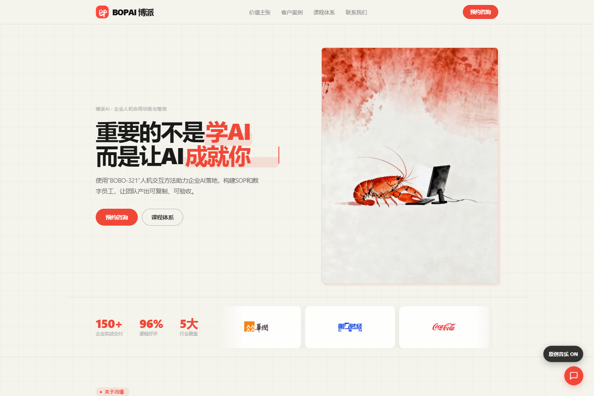

# 冯博 Gatsby｜博派AI创始人

**企业AI培训与落地实践：让管理者找到方向，让团队完成真实工作，让经验变成可复用的工具。**

[博派官网 · www.bopai.online](https://www.bopai.online/) · [GitHub已发布成果](#github已发布成果) · [培训与合作](mailto:fengbo.football@foxmail.com)

## 专业资质与业务经历

- **微软AI工程师认证**，**2025世界人工智能大会特邀分享嘉宾**。
- **前趣店集团（NYSE：QD）CEO助理、创始敲钟团成员**，经历企业从初创到上市，参与消费金融、电商、数据风控与增长业务。
- **前艾瑞咨询集团COO助理**；现为博派AI创始人，专注企业AI培训、工作流与业务应用。
- **南开大学深圳校友会理事、初善创投AI创业导师**，“AI召唤师”社群主理人。

### 部分服务客户

| 领域 | 培训与项目服务经历 |
|---|---|
| 央国企与产业集团 | **华润集团、中国移动、南方电网、中远海运、广药集团** |
| 金融与保险 | **招商银行、兴业银行、中信银行、中国人民保险、中国人寿保险** |
| 互联网与消费品牌 | **腾讯、字节跳动、京东、可口可乐、格力、盼盼食品** |

讲师资质与服务经历据2026年讲师简介；[授课现场与客户公开评价](https://www.bopai.online/#cases)见官网。

## 我能帮你的团队解决什么问题？

| 团队当前的问题 | 合作方向 | 围绕什么成果展开 |
|---|---|---|
| 管理者知道AI重要，但不知道从哪里投入 | **管理者AI增长工作坊** | 找到高价值场景，形成试点优先级、推进方案和验收标准 |
| 文档、PPT、Excel等重复工作耗时 | **职场办公增效工作坊** | 用真实材料完成文档与分析任务，沉淀岗位提示词和操作方法 |
| AI偶尔好用，团队难以稳定复用 | **业务型智能体工作坊** | 将任务写成SOP，制作工作流、智能体或Skill，明确操作权限与复核环节 |
| 营销内容与获客动作零散，缺少持续机制 | **获客营销引擎工作坊** | 围绕客户与场景，设计内容方案、营销素材和线索处理流程 |

以 **1—2天线下工作坊** 为主，支持行业定制与企业线上培训。课前了解学员基础与业务任务，课堂实操、展示、互评，课后沉淀可复用成果。具体交付随需求与课时确定。

**BOBO-321**：先交代背景，再口述需求，明确边界后执行与复核；以精通工具、定制技能、重构工作体系为学习方向。[查看完整课程体系](https://www.bopai.online/#courses)。

> 更少的概念、工具与技巧；更多的实操、作品与产出。  
> **No tell, just show.**

## GitHub已发布成果

这里展示已经公开的课程资产和工具。每个项目都能打开查看内容，按说明下载或使用。

### 博AI课程设计套件｜7项Skill

把课程研发串成完整流程：**价值观 → 学员调研 → 课纲 → 业务案例 → 教学数据 → PPT → 授课复盘**。

面向讲师、课程研发与培训团队，提供可交给Agent使用的规则、参考资料和配套文件。

[打开课程合集](https://github.com/Captainf5/boai-course) · [安装与使用指南](https://github.com/Captainf5/boai-course/blob/main/GUIDE.md)

### BOBO数据分析｜v4.1.0

支持**直接分析**与**学习带练**：读取Excel、核对数据、计算指标，交付有依据的结论和行动建议；学习时解释公式、步骤与检查方法，按需输出分析副本或离线网页报告。

[打开数据分析Skill](https://github.com/Captainf5/bobo-data-analysis) · [查看使用说明](https://github.com/Captainf5/bobo-data-analysis/blob/main/GUIDE.md)

### Excel公式练习台

提供查找引用、逻辑判断、统计聚合等公式练习，配有提示、答案与解析。已公开网页源码，可下载后按项目说明在本地打开。

[查看练习台与源码](https://github.com/Captainf5/Excel-)

### Agent任务技能库

已公开**公文自检助手**与**Agent员工化技能**：帮助检查正式材料，或为Agent明确角色、流程与工作边界。项目来源、适配与使用方式以仓库说明为准。

[查看任务技能库](https://github.com/Captainf5/Agent-Skill)

**boai-** 用于课程设计；**bobo-** 面向个人通用工具；**bopai-** 用于博派公司内部。第三方学习参考收在页面下方。

## 博派官网｜课程、现场与合作信息

**[www.bopai.online · 点击进入官网](https://www.bopai.online/)**

官网实拍于2026-11-02，点击截图查看当前页面及完整课程信息。

## 联系我，讨论一个具体的业务问题

来信说明：**团队与岗位、想解决的工作问题、希望带走的成果、人数与基础、预计培训时间**。

**商务邮箱：[fengbo.football@foxmail.com](mailto:fengbo.football@foxmail.com)** · [官网预约咨询](https://www.bopai.online/#contact)

我是讲师或Agent使用者：完整项目导航、历史入口与第三方Fork

## 完整项目导航
| 项目 | 解决什么问题 | 入口 |
|---|---|---|
| **博AI增效课程 Skill 套件** | 理念、课前调研、课纲、案例、教学数据、PPT和讲课录音复盘，七项独立Skill组成课程设计闭环 | **[打开课程合集](https://github.com/Captainf5/boai-course)** |
| **BOBO数据分析 Skill** | 直接分析运营营销数据，或带学员学习Excel方法；交付可追溯的计算、结论和行动 | [打开独立数据分析](https://github.com/Captainf5/bobo-data-analysis) |
| **Excel公式练习台** | 为课程学员提供常见Excel公式的交互练习 | [查看教学工具](https://github.com/Captainf5/Excel-) |
| **Agent技能库** | 我维护的其他任务型Skill，与课程设计合集分开 | [查看Agent-Skill](https://github.com/Captainf5/Agent-Skill) |

### 课程设计：直接找你要做的事

| 我要做什么 | 使用哪个Skill |
|---|---|
| 讨论课程方向、课后验收 | [boai-course-value](https://github.com/Captainf5/boai-course/tree/main/boai-course-value) |
| 建学员问卷、分析需求并交付报告 | [boai-questionnaire](https://github.com/Captainf5/boai-course/tree/main/boai-questionnaire) |
| 定制课纲、交付Word与PDF | [boai-kegang](https://github.com/Captainf5/boai-course/tree/main/boai-kegang) |
| 制作学员版与教练版业务案例 | [boai-showcase](https://github.com/Captainf5/boai-course/tree/main/boai-showcase) |
| 制作教学模拟数据与练习 | [boai-zengxiao-data-case](https://github.com/Captainf5/boai-course/tree/main/boai-zengxiao-data-case) |
| 共创逐页脚本、制作教学PPT | [boai-ppt](https://github.com/Captainf5/boai-course/tree/main/boai-ppt) |
| 从授课录音提炼改课建议 | [boai-recording-review](https://github.com/Captainf5/boai-course/tree/main/boai-recording-review) |

通用数据分析和日常提示词优化属于独立用途，不混入课程设计合集。各项目的运行依赖、账号授权和验证范围以项目说明为准。

## 历史入口

[旧课纲仓库 bopai_kegang](https://github.com/Captainf5/bopai_kegang)保留历史资料；后续课程设计Skill优先使用上方的博AI课程合集。

## 学习参考与 Fork

下面是第三方开源项目的学习参考，**不是我的原创作品**。原作者、许可证与贡献记录以各自上游仓库为准；我的Fork保留在仓库列表中。

展开第三方项目与原作者入口

- 商业与内容：[dontbesilent2025/dbskill](https://github.com/dontbesilent2025/dbskill)、[coreyhaines31/marketingskills](https://github.com/coreyhaines31/marketingskills)
- Agent与开发：[hesamsheikh/awesome-openclaw-usecases](https://github.com/hesamsheikh/awesome-openclaw-usecases)、[paperclipai/paperclip](https://github.com/paperclipai/paperclip)、[anomalyco/opencode](https://github.com/anomalyco/opencode)、[volcengine/OpenViking](https://github.com/volcengine/OpenViking)、[tanweai/pua](https://github.com/tanweai/pua)
- 设计：[vigorX777/product-design-system](https://github.com/vigorX777/product-design-system)、[nextlevelbuilder/ui-ux-pro-max-skill](https://github.com/nextlevelbuilder/ui-ux-pro-max-skill)、[Lucent-Snow/style-extractor](https://github.com/Lucent-Snow/style-extractor)、[Gmasterzhangxinyang/jarvis-amber-protocol-hud](https://github.com/Gmasterzhangxinyang/jarvis-amber-protocol-hud)、[liseami/screenshot-to-code](https://github.com/liseami/screenshot-to-code)
- 数据与工具：[D4Vinci/Scrapling](https://github.com/D4Vinci/Scrapling)、[NanmiCoder/MediaCrawler](https://github.com/NanmiCoder/MediaCrawler)、[firecrawl/firecrawl](https://github.com/firecrawl/firecrawl)、[BlueMatthew/WechatExporter](https://github.com/BlueMatthew/WechatExporter)、[axcore/tartube](https://github.com/axcore/tartube)、[hacksider/Deep-Live-Cam](https://github.com/hacksider/Deep-Live-Cam)
- 学习资料：[mihail911/modern-software-dev-assignments](https://github.com/mihail911/modern-software-dev-assignments)

介绍来源：冯博老师简介—2026简约版、博派官网；GitHub项目核对日期：2026-11-02。页面设计方法参考[花叔 huashu-design](https://github.com/alchaincyf/huashu-design)。
