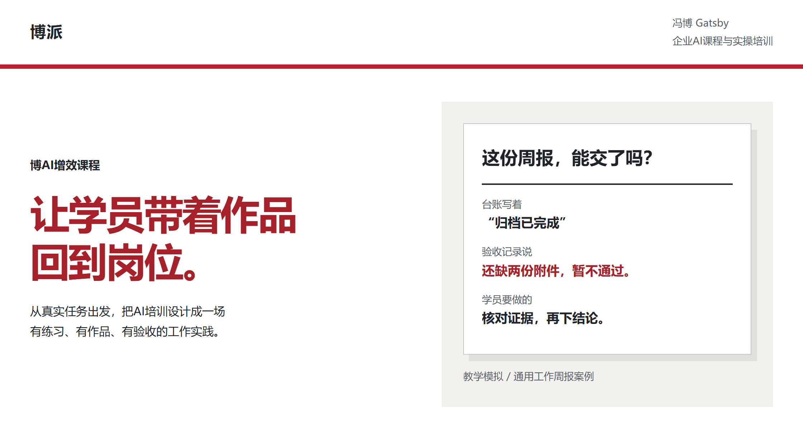
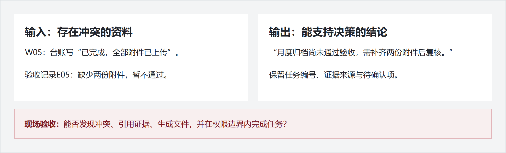

# 冯博 Gatsby｜博派企业AI实操培训

<picture>
  <source media="(max-width: 600px)" srcset="assets/readme/hero-mobile.png">
  
</picture>

**从真实任务出发，让学员带着作品回到岗位。** 我是冯博 Gatsby，围绕企业的岗位、任务与学员基础，设计可练习、可交付、可验收的AI课程。

[看课程设计合集](https://github.com/Captainf5/boai-course) · [看完整教学案例](https://github.com/Captainf5/boai-course/blob/main/examples/weekly-report-pcr.md) · [fengbo.football@foxmail.com](mailto:fengbo.football@foxmail.com)

## 先看一项练习：做出可信的工作周报

学员拿到工作台账、群消息与验收记录，把它们整理成主管可用的一页周报。资料里有冲突，学员必须找到证据，再给出结论。

<picture>
  <source media="(max-width: 600px)" srcset="assets/readme/case-mobile.png">
  
</picture>

这项练习的目标产物是：**工作周报、证据核查表、可复用流程**。现场看能否发现冲突、引用证据、生成文件，并在权限边界内完成任务。

[阅读学员材料、课堂流程与教练说明](https://github.com/Captainf5/boai-course/blob/main/examples/weekly-report-pcr.md)。示例为公开的教学模拟草案，尚不代表已完成课堂试讲或所有工具的端到端实测。

## 一门课，交付不止一套PPT

| 阶段 | 先回答的问题 | 可设计的交付物 |
|---|---|---|
| 课前 | 谁来学？要完成什么岗位任务？ | 学员调研、需求分析、定制课纲 |
| 课堂 | 怎样动手？怎样发现并修正错误？ | 实操案例、练习材料、作品与验收清单 |
| 课后 | 什么值得保留？下一次怎么改？ | 授课复盘、改进建议、可复用模板 |

具体范围根据客户需求、课时、材料与预算确定。

我们在条件允许时，通过问卷或访谈了解需求；围绕作品倒推练习，让学员小组合作、展示、互评和修改。

> 更少的概念、工具与技巧；更多的实操、作品与产出。  
> **No tell, just show.**

## 从你的用途出发

| 我想做什么 | 入口 |
|---|---|
| 为团队设计一门AI实操课 | [博AI课程设计合集：调研、课纲、案例、PPT与复盘](https://github.com/Captainf5/boai-course) |
| 分析日常数据，或学习Excel分析方法 | [BOBO数据分析：直接执行与带练两种模式](https://github.com/Captainf5/bobo-data-analysis) |
| 练习常用Excel公式 | [Excel公式练习台](https://github.com/Captainf5/Excel-) |

**boai-** 专注课程设计；**bobo-** 面向个人通用工具；**bopai-** 用于博派公司内部。前缀表示用途，内部资料不因此公开。

## 说一个你们想解决的工作问题

来信说明：**团队与岗位、希望完成的任务、理想产物、学员人数与基础、预计培训时间**。我们据此讨论课程范围和准备材料。

**商务联系：[fengbo.football@foxmail.com](mailto:fengbo.football@foxmail.com)**

首次沟通不需要提供密码、账号凭据或未经批准外传的业务资料。

我是讲师或Agent使用者：完整项目导航、历史入口与第三方Fork

## 完整项目导航
| 项目 | 解决什么问题 | 入口 |
|---|---|---|
| **博AI增效课程 Skill 套件** | 理念、课前调研、课纲、案例、教学数据、PPT和讲课录音复盘，七项独立Skill组成课程设计闭环 | **[打开课程合集](https://github.com/Captainf5/boai-course)** |
| **BOBO数据分析 Skill** | 直接分析运营营销数据，或带学员学习Excel方法；交付可追溯的计算、结论和行动 | [打开独立数据分析](https://github.com/Captainf5/bobo-data-analysis) |
| **Excel公式练习台** | 为课程学员提供常见Excel公式的交互练习 | [查看教学工具](https://github.com/Captainf5/Excel-) |
| **Agent技能库** | 我维护的其他任务型Skill，与课程设计合集分开 | [查看Agent-Skill](https://github.com/Captainf5/Agent-Skill) |

### 课程设计：直接找你要做的事

| 我要做什么 | 使用哪个Skill |
|---|---|
| 讨论课程方向、课后验收 | [boai-course-value](https://github.com/Captainf5/boai-course/tree/main/boai-course-value) |
| 建学员问卷、分析需求并交付报告 | [boai-questionnaire](https://github.com/Captainf5/boai-course/tree/main/boai-questionnaire) |
| 定制课纲、交付Word与PDF | [boai-kegang](https://github.com/Captainf5/boai-course/tree/main/boai-kegang) |
| 制作学员版与教练版业务案例 | [boai-showcase](https://github.com/Captainf5/boai-course/tree/main/boai-showcase) |
| 制作教学模拟数据与练习 | [boai-zengxiao-data-case](https://github.com/Captainf5/boai-course/tree/main/boai-zengxiao-data-case) |
| 共创逐页脚本、制作教学PPT | [boai-ppt](https://github.com/Captainf5/boai-course/tree/main/boai-ppt) |
| 从授课录音提炼改课建议 | [boai-recording-review](https://github.com/Captainf5/boai-course/tree/main/boai-recording-review) |

[通用工作周报PCR案例：给Agent即可制作教学PPT](https://github.com/Captainf5/boai-course/blob/main/examples/weekly-report-pcr.md)

通用数据分析和日常提示词优化属于独立用途，不混入课程设计合集。各项目的运行依赖、账号授权和验证范围以项目说明为准。

## 历史入口

[旧课纲仓库 bopai_kegang](https://github.com/Captainf5/bopai_kegang)保留历史资料；后续课程设计Skill优先使用上方的博AI课程合集。

## 学习参考与 Fork

下面是第三方开源项目的学习参考，**不是我的原创作品**。原作者、许可证与贡献记录以各自上游仓库为准；我的Fork保留在仓库列表中。

展开第三方项目与原作者入口

- 商业与内容：[dontbesilent2025/dbskill](https://github.com/dontbesilent2025/dbskill)、[coreyhaines31/marketingskills](https://github.com/coreyhaines31/marketingskills)
- Agent与开发：[hesamsheikh/awesome-openclaw-usecases](https://github.com/hesamsheikh/awesome-openclaw-usecases)、[paperclipai/paperclip](https://github.com/paperclipai/paperclip)、[anomalyco/opencode](https://github.com/anomalyco/opencode)、[volcengine/OpenViking](https://github.com/volcengine/OpenViking)、[tanweai/pua](https://github.com/tanweai/pua)
- 设计：[vigorX777/product-design-system](https://github.com/vigorX777/product-design-system)、[nextlevelbuilder/ui-ux-pro-max-skill](https://github.com/nextlevelbuilder/ui-ux-pro-max-skill)、[Lucent-Snow/style-extractor](https://github.com/Lucent-Snow/style-extractor)、[Gmasterzhangxinyang/jarvis-amber-protocol-hud](https://github.com/Gmasterzhangxinyang/jarvis-amber-protocol-hud)、[liseami/screenshot-to-code](https://github.com/liseami/screenshot-to-code)
- 数据与工具：[D4Vinci/Scrapling](https://github.com/D4Vinci/Scrapling)、[NanmiCoder/MediaCrawler](https://github.com/NanmiCoder/MediaCrawler)、[firecrawl/firecrawl](https://github.com/firecrawl/firecrawl)、[BlueMatthew/WechatExporter](https://github.com/BlueMatthew/WechatExporter)、[axcore/tartube](https://github.com/axcore/tartube)、[hacksider/Deep-Live-Cam](https://github.com/hacksider/Deep-Live-Cam)
- 学习资料：[mihail911/modern-software-dev-assignments](https://github.com/mihail911/modern-software-dev-assignments)

页面设计方法参考 [花叔 huashu-design](https://github.com/alchaincyf/huashu-design)。页面内容与教学案例来自博派；示例不作为客户效果承诺。
